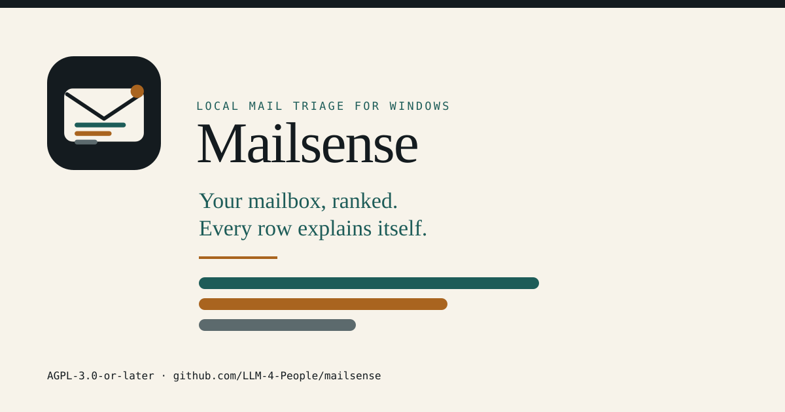

<!-- Generated by cmd/gensite from docs/site.json. DO NOT EDIT. -->

# Mailsense

**Mailsense turns your Outlook mailbox into a ranked list of what needs you,
with the reason on every row.**

It reads the classic Outlook profile already open on your PC. The message store,
the classifier and the learned profile stay on your disk. A remote model runs
only when you add one.



[Français](README.fr.md) · [Documentation](docs/index.md) · [Install](docs/install.md) · [First run](docs/first-run.md) · [Console](docs/console.md) · [Mailboxes](docs/mailboxes.md) · [Providers](docs/providers.md) · [Learning](docs/learning.md) · [FAQ](docs/faq.md) · [Privacy](docs/privacy.md) · [Security](docs/security.md) · [Troubleshooting](docs/troubleshooting.md) · [Contributing](docs/contributing.md) · [Docs site](https://llm-4-people.github.io/mailsense/)

## Three things it does differently

- **Every label names its source.** A decision is stored as answers to named
  questions, with the confidence each answer carries where the question type has
  one and the evidence behind it. The message detail shows the fields the model
  read. When an index is partial, the screen names the missing part.
- **The queue is scored by a fixed local policy.** A local Go scorer ranks each
  message from stored signals: a suspicious message adds 100, a decision 45, a
  reply 30, urgency and deadline levels add fixed weights, and recency adds at
  most 12. A score of 20 is the floor, and a suspicious, decision, reply, urgent
  or deadline signal always enters. Bulk automated mail never enters, however
  urgent its text.
- **It abstains until your own labels certify it.** The local classifier trains
  one head per question on your corrections. A question is certified only when
  the Wilson lower bound of its answered precision reaches 0.99 on a held-out
  split, with at least 200 training labels, 50 evaluation labels and 0.5
  coverage. Below that threshold it abstains, and the Learning screen names the
  stage that blocks it.

## What leaves the machine

Mailsense makes four kinds of network request. Each one has a reason you can
see.

**Leaves, only when it runs**

- The pinned local runtime and embedding model, downloaded once and checked
  against SHA-256 before use.
- A request to a remote provider you configured, including automatic triage
  after a sync. It carries the message fields that call needs.
- A provider model list when you press Fetch models.
- One small test request when you press Test. A test is billable and is not
  covered by a budget.

**Never leaves**

- The mail store, attachments, indexes and learned profile. They are SQLite
  files in the data directory you chose.
- The classification, evidence and ranking code. They run as local Go code, not
  as a cloud call.
- No telemetry, no analytics, no update ping and no vendor account.

Mailsense reads the classic Outlook profile already open on Windows. It does not
ask for Microsoft credentials. A remote provider's terms govern what it does
with a request you send. See [privacy](docs/privacy.md).

## What it cannot do yet

- **Only classic Outlook on Windows is a live source.** It reads the profile
  through COM. New Outlook, Outlook on the web, IMAP, POP, the Gmail API,
  Microsoft Graph and file import are not connected in this build.
- **The Linux build is a preview.** It opens, renders every screen and explains
  the missing source. The inbox stays empty because there is no live connector
  yet.
- **It reads and ranks. It does not act on the mailbox.** No sending, deleting,
  moving or read-state changes. The connector is read-only.
- **Triage needs a decider.** Without one, triage answers 422
  provider_not_configured. Search and the local classifier still work.
- **The database is not encrypted by the app.** Your operating-system account
  and disk encryption are the protection. Provider keys on Windows use DPAPI.
- **There is no SQL console and no diagnostics bundle.** Logs are local and
  readable in the Logs screen. They redact secrets.

## Install

**Windows.** Download the per-user installer from
[Releases](https://github.com/LLM-4-People/mailsense/releases). It needs the
Microsoft Edge WebView2 runtime, which Windows 11 and current Windows 10 already
have. The build is not code-signed, so Windows may ask you to confirm the
publisher.

**Linux.** Download the amd64 tarball, extract it and run install.sh for a menu
entry, or run the binary directly.

```bash
tar -xzf mailsense-*-linux-amd64.tar.gz && cd mailsense-*-linux-amd64 && ./install.sh
```

One command for the Linux preview, from the directory that holds the downloaded
tarball.

[Read the first-run guide](docs/first-run.md)

## Status

Mailsense is in active development. Interfaces and stored schemas may change
between releases; the changelog and the release notes call out anything that
requires a migration.

## Build from source

Go (the version in `go.mod`), Node 22 for the UI test harnesses, and optionally
Playwright for the browser suite.

```bash
scripts/build.sh all        # dist/mailsense and dist/mailsense.exe
scripts/test-fast.sh        # gofmt, vet, script checks, unit and contract suites
scripts/test.sh             # exhaustive release gate
```

The UI is plain modules under `internal/ui/js`, concatenated into one bundle by
`go generate ./internal/ui`. Architecture and ownership rules are in
`docs/ARCHITECTURE.md`.

## License

Mailsense is licensed under the GNU Affero General Public License, version 3 or
later (AGPL-3.0-or-later). You can use it, study it, change it and share it. If
you run a modified version as a network service, the AGPL requires you to offer
the corresponding source to the people who use it. See `LICENSE` for the full
text and `NOTICE` for the copyright and third-party notices.

[Documentation](https://llm-4-people.github.io/mailsense/)
