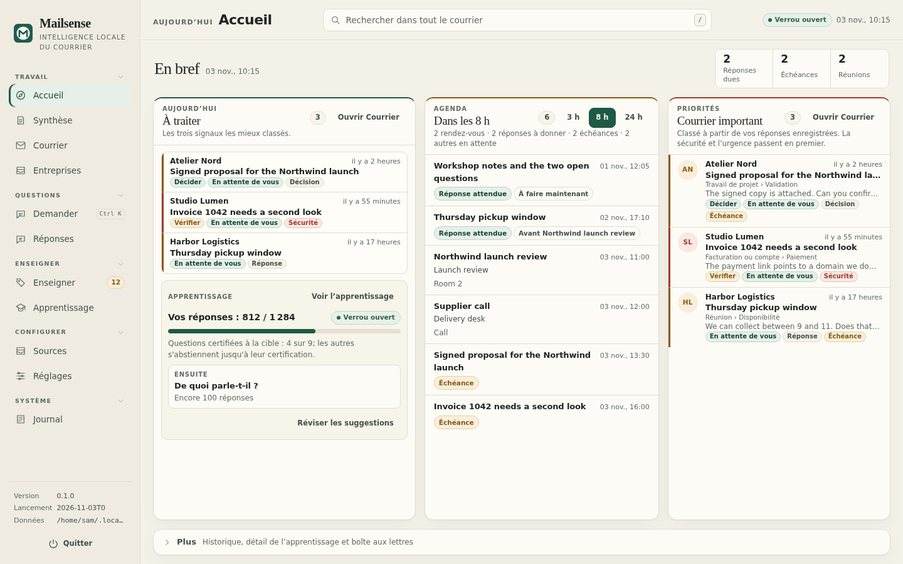
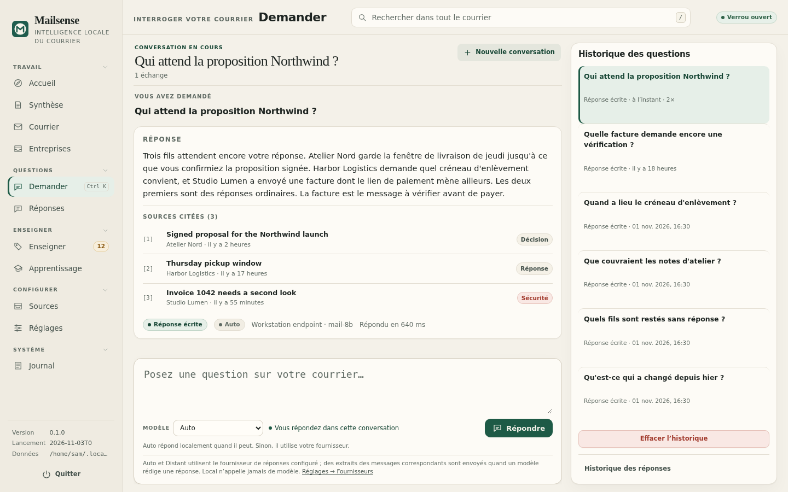
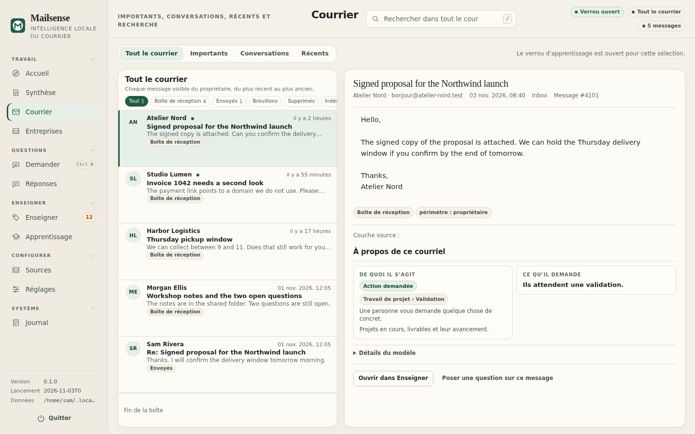
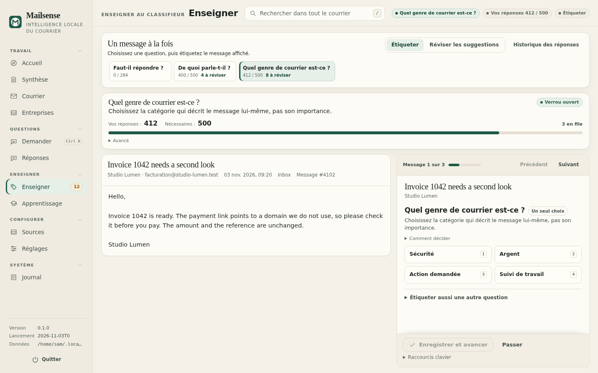
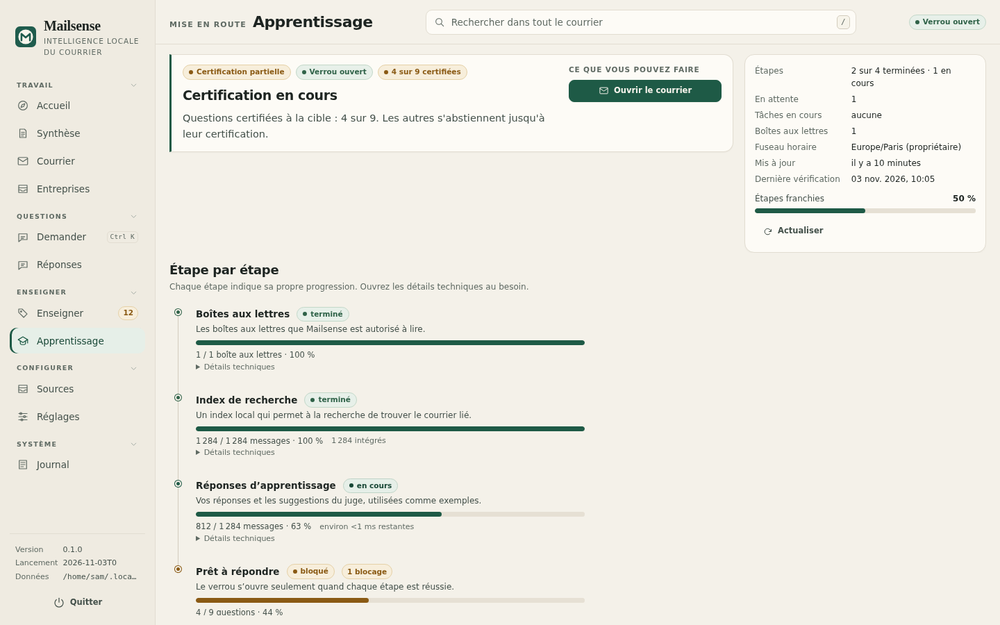
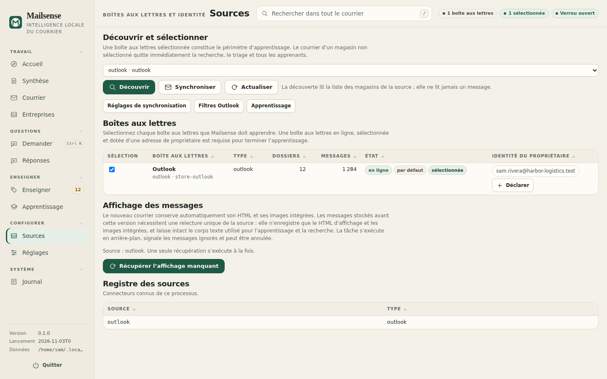
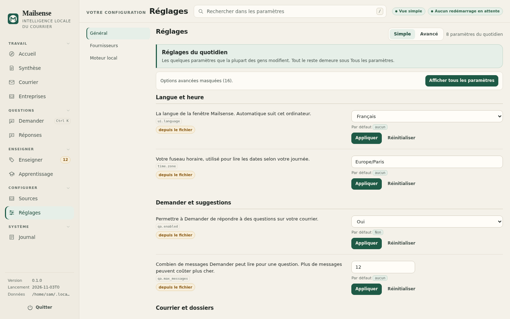
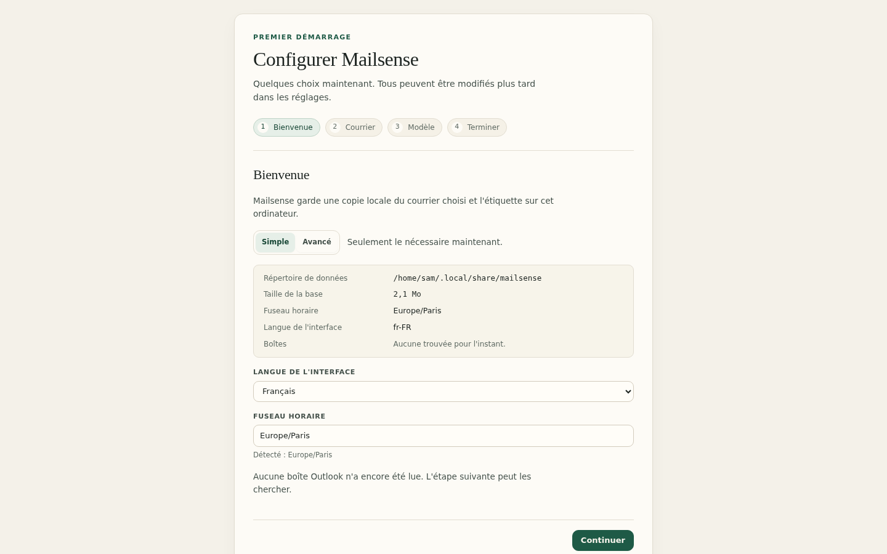

<header class="hero">
  

    

      <h1 class="promise" id="thesis-title">Posez une question à votre courrier. Il répond par un décompte, une liste ou une réponse écrite qui cite les messages utilisés.</h1>
      
Il lit le profil Outlook classique déjà ouvert sur votre PC. Ask répond depuis l&#39;index local ; une réponse écrite ne vient que d&#39;un modèle que vous avez configuré et des messages qu&#39;il peut citer. Le stockage, le classifieur et le profil appris restent sur votre disque.

      
<a class="button" href="install.html">Installer</a><a class="quiet-link" href="first-run.html">Lire le guide du premier démarrage</a>

      
Installateur Windows. Sans compte, sans télémétrie.

    

    

      <figure class="app-window">
        

          
          Mailsense
          Aperçu
        

        
      </figure>
      <aside class="answer-slip" aria-labelledby="slip-label">
        

          
ASK / RÉPONSE ANCRÉE

          
            Exemple de réponse
            Auto
          
        

        
Qui attend la proposition Northwind ?

        
Trois fils attendent encore votre réponse. Atelier Nord garde la fenêtre de livraison de jeudi jusqu&#39;à ce que vous confirmiez la proposition signée. Harbor Logistics demande quel créneau d&#39;enlèvement convient, et Studio Lumen a envoyé une facture dont le lien de paiement mène ailleurs. Les deux premiers sont des réponses ordinaires. La facture est le message à vérifier avant de payer.

        <ol class="citations">
          <li>
            01
            
              Proposition signée pour le lancement Northwind
              Atelier Nord · 3 nov. 2026
            
          </li>
          <li>
            02
            
              Créneau d&#39;enlèvement du jeudi
              Harbor Logistics · 2 nov. 2026
            
          </li>
          <li>
            03
            
              La facture 1042 demande une vérification
              Studio Lumen · 3 nov. 2026
            
          </li>
        </ol>
        
Dans l&#39;application, chaque citation ouvre le message qu&#39;elle nomme.

      </aside>
    

  

</header>

<section class="section section-ask" aria-labelledby="ask-title">
  

    

      <h2 id="ask-title">Commencez par une question</h2>
      
Ask répond en clair à une question sur votre courrier. L&#39;écran nomme le mécanisme qui a répondu : une requête typée, une recherche ou un modèle que vous avez configuré.

    

    

      <article class="ask-card ask-card-grounding">
        

          01
          Ancrage
        

        <h3>Une réponse écrite cite chaque message utilisé.</h3>
        
Le modèle doit écrire au plus 120 mots et marque chaque affirmation par un numéro de message. Le serveur vérifie chaque marqueur contre l&#39;ensemble récupéré, refuse une réponse dont un marqueur pointe hors de cet ensemble, renumérote les marqueurs en positions de citation et ne garde une citation que si elle nomme un message réel. Quand aucune citation ne survit, les messages correspondants restent à l&#39;écran avec un avis qui nomme la cause.

        <ul class="mini-cites">
          <li>
            
            Proposition signée pour le lancement Northwind
            Atelier Nord
          </li>
          <li>
            
            Créneau d&#39;enlèvement du jeudi
            Harbor Logistics
          </li>
          <li>
            
            La facture 1042 demande une vérification
            Studio Lumen
          </li>
        </ul>
      </article>
      <article class="ask-card ask-card-local">
        

          02
          Local
        

        <h3>Un décompte ou un classement est calculé, pas rédigé.</h3>
        
Un décompte, un classement et le profil d&#39;une organisation sont lus dans l&#39;index local et les faits stockés. Le nombre et les lignes viennent d&#39;une requête typée, jamais d&#39;un texte de modèle. Le mode Local n&#39;appelle jamais de modèle : le même décompte répond quand même, et une question libre renvoie les messages correspondants avec un avis qui dit que Local n&#39;appelle jamais de modèle.

        

          Auto
          Local
          Distant
        

      </article>
      <article class="ask-card ask-card-trace">
        

          03
          Trace
        

        <h3>Une citation ouvre le message, et la réponse est conservée.</h3>
        
Chaque ligne de citation porte l&#39;objet, l&#39;expéditeur et la date, et mène au message qu&#39;elle nomme. Chaque réponse est conservée avec sa question, sa route, son mode, ses citations et, quand un modèle a servi, son fournisseur et son modèle. Le rail d&#39;historique la rouvre, et Effacer l&#39;historique retire toutes les réponses conservées.

        

          
          Qui attend la proposition Northwind ?
        

      </article>
    

    

      

        <h3 id="modes-title">Trois modes, une règle</h3>
        <table class="mode-table" aria-labelledby="modes-title">
          <thead><tr><th scope="col">Mode</th><th scope="col">Ce qui répond</th><th scope="col">Quand un modèle est appelé</th></tr></thead>
          <tbody>
            <tr>
              <th scope="row" data-label="Mode">Auto</th>
              <td data-label="Ce qui répond">L&#39;index local et le classement quand la question a une réponse exacte, sinon le fournisseur configuré ou les messages correspondants.</td>
              <td data-label="Quand un modèle est appelé">Seulement pour une question qu&#39;aucune intention exacte ne couvre.</td>
            </tr>
            <tr>
              <th scope="row" data-label="Mode">Local</th>
              <td data-label="Ce qui répond">L&#39;index local, le classement et le profil stocké.</td>
              <td data-label="Quand un modèle est appelé">Jamais.</td>
            </tr>
            <tr>
              <th scope="row" data-label="Mode">Distant</th>
              <td data-label="Ce qui répond">Le fournisseur configuré, ancré dans les messages récupérés.</td>
              <td data-label="Quand un modèle est appelé">Pour chaque question avec des preuves récupérées. Proposé seulement quand un fournisseur est utilisable.</td>
            </tr>
          </tbody>
        </table>
      

      

        
Chaque citation ouvre le message qu&#39;elle nomme, et chaque réponse est conservée avec sa question pour être rouverte.

        
Ask est borné par <code>qa.max_messages</code>, <code>qa.retrieval_timeout</code>, <code>qa.call_timeout</code> et les deux réglages de budget. Un index en préparation garde la question et propose Réessayer.

        
<a href="ask.html">Lire le guide Ask</a>

      

    

  

</section>

<section class="section section-queue" aria-labelledby="queue-title">
  

    

      <h2 id="queue-title">Trois choses qu&#39;il fait autrement</h2>
      
La file, la preuve et le verrou. Chacune est un mécanisme que vous pouvez inspecter.

    

    

      

        
Une file inventée. Le score suit une règle locale, pas un appel à un modèle.

        <table class="queue-table">
          <thead><tr><th scope="col">Rang</th><th scope="col">Objet</th><th scope="col">Expéditeur</th><th scope="col">Action</th></tr></thead>
          <tbody>
            <tr>
              <th scope="row" class="queue-rank">01</th>
              <td class="queue-subject">Proposition signée pour le lancement Northwind</td>
              <td class="queue-sender">Atelier Nord</td>
              <td class="queue-action">Décider</td>
            </tr>
            <tr>
              <th scope="row" class="queue-rank">02</th>
              <td class="queue-subject">La facture 1042 demande une vérification</td>
              <td class="queue-sender">Studio Lumen</td>
              <td class="queue-action">Vérifier</td>
            </tr>
            <tr>
              <th scope="row" class="queue-rank">03</th>
              <td class="queue-subject">Créneau d&#39;enlèvement du jeudi</td>
              <td class="queue-sender">Harbor Logistics</td>
              <td class="queue-action">Répondre</td>
            </tr>
            <tr>
              <th scope="row" class="queue-rank">04</th>
              <td class="queue-subject">Notes d&#39;atelier et les deux questions ouvertes</td>
              <td class="queue-sender">Morgan Ellis</td>
              <td class="queue-action">Lire</td>
            </tr>
          </tbody>
        </table>
      

      

        

          <article class="queue-item">
            01
            
File

            <h3>La file est ordonnée par une règle locale fixe.</h3>
            
Un moteur Go local ordonne chaque message à partir des signaux stockés : un message suspect ajoute 100, une décision 45, une réponse 30, les niveaux d&#39;urgence et d&#39;échéance ajoutent des poids fixes, et la date de réception ajoute au plus 12. Un score de 20 suffit pour entrer, et un signal de suspicion, de décision, de réponse, d&#39;urgence ou d&#39;échéance entre toujours. Le courrier automatisé de masse n&#39;entre jamais, quelle que soit l&#39;urgence de son texte.

          </article>
          <article class="queue-item">
            02
            
Preuve

            <h3>Chaque étiquette nomme sa source.</h3>
            
Une décision est stockée comme des réponses à des questions nommées, avec la confiance de chaque réponse quand ce type de question en porte une et les éléments de preuve qui la soutiennent. Le détail du message montre les champs lus par le modèle. Quand un index est partiel, l&#39;écran nomme la partie manquante.

          </article>
          <article class="queue-item">
            03
            
Apprentissage

            <h3>Il s&#39;abstient tant que vos propres étiquettes ne l&#39;ont pas certifié.</h3>
            
Le classifieur local entraîne une tête par question sur vos corrections. Une question n&#39;est certifiée que lorsque la borne inférieure de Wilson de sa précision répondue atteint 0,99 sur une partition mise de côté, avec au moins 200 étiquettes d&#39;entraînement, 50 étiquettes d&#39;évaluation et une couverture de 0,5. En dessous, il s&#39;abstient, et l&#39;écran Apprentissage nomme l&#39;étape qui bloque.

          </article>
        

      

    

  

</section>

<section class="section section-screens" aria-labelledby="screens-title">
  

    

      <h2 id="screens-title">Les écrans, à commencer par Ask</h2>
      
Capturés depuis l&#39;aperçu Linux avec une boîte inventée. Aucun courrier réel n&#39;apparaît ici.

    

    

      <fieldset class="screen-index" aria-describedby="screen-hint">
        <legend class="visually-hidden">Index des écrans</legend>
        

          
Index des écrans

          
Choisissez un écran. Les flèches permettent de passer d&#39;un écran à l&#39;autre.Choisissez un écran.

        

        

          <label class="screen-tab" for="screen-ask">
            <input class="screen-radio" type="radio" name="screen" id="screen-ask" checked>
            01
            Demander avec une réponse
          </label>
          <label class="screen-tab" for="screen-home">
            <input class="screen-radio" type="radio" name="screen" id="screen-home">
            02
            Accueil
          </label>
          <label class="screen-tab" for="screen-mail">
            <input class="screen-radio" type="radio" name="screen" id="screen-mail">
            03
            Courrier avec un message ouvert
          </label>
          <label class="screen-tab" for="screen-teach">
            <input class="screen-radio" type="radio" name="screen" id="screen-teach">
            04
            Enseigner
          </label>
          <label class="screen-tab" for="screen-learning">
            <input class="screen-radio" type="radio" name="screen" id="screen-learning">
            05
            Apprentissage
          </label>
          <label class="screen-tab" for="screen-sources">
            <input class="screen-radio" type="radio" name="screen" id="screen-sources">
            06
            Sources
          </label>
          <label class="screen-tab" for="screen-settings">
            <input class="screen-radio" type="radio" name="screen" id="screen-settings">
            07
            Réglages
          </label>
          <label class="screen-tab" for="screen-first_run">
            <input class="screen-radio" type="radio" name="screen" id="screen-first_run">
            08
            Premier démarrage
          </label>
        

        

          <figure class="shot" id="shot-ask">
            

              
            

            <a class="shot-full" href="../assets/screenshots/fr/ask.png" target="_blank" rel="noopener">Voir en plein format</a>
            <figcaption><strong>Demander avec une réponse</strong> Ask mène : une question et sa réponse écrite, avec chaque citation sous le texte qui ouvre le message qu&#39;elle nomme.</figcaption>
          </figure>
          <figure class="shot" id="shot-home">
            

              
            

            <a class="shot-full" href="../assets/screenshots/fr/home.png" target="_blank" rel="noopener">Voir en plein format</a>
            <figcaption><strong>Accueil</strong> La journée en trois colonnes : ce qui attend une réponse, ce qui attend une décision et ce qui arrive.</figcaption>
          </figure>
          <figure class="shot" id="shot-mail">
            

              
            

            <a class="shot-full" href="../assets/screenshots/fr/mail.png" target="_blank" rel="noopener">Voir en plein format</a>
            <figcaption><strong>Courrier avec un message ouvert</strong> Le message choisi montre son expéditeur, son corps et les champs lus par le modèle local.</figcaption>
          </figure>
          <figure class="shot" id="shot-teach">
            

              
            

            <a class="shot-full" href="../assets/screenshots/fr/teach.png" target="_blank" rel="noopener">Voir en plein format</a>
            <figcaption><strong>Enseigner</strong> Une question à la fois. La suggestion est affichée, et votre réponse est l&#39;étiquette qui entraîne le modèle local.</figcaption>
          </figure>
          <figure class="shot" id="shot-learning">
            

              
            

            <a class="shot-full" href="../assets/screenshots/fr/learning.png" target="_blank" rel="noopener">Voir en plein format</a>
            <figcaption><strong>Apprentissage</strong> Chaque étape indique sa progression, et l&#39;écran nomme l&#39;étape qui bloque encore la certification.</figcaption>
          </figure>
          <figure class="shot" id="shot-sources">
            

              
            

            <a class="shot-full" href="../assets/screenshots/fr/sources.png" target="_blank" rel="noopener">Voir en plein format</a>
            <figcaption><strong>Sources</strong> Le stockage Outlook, la boîte choisie et les dossiers que Mailsense peut lire.</figcaption>
          </figure>
          <figure class="shot" id="shot-settings">
            

              
            

            <a class="shot-full" href="../assets/screenshots/fr/settings.png" target="_blank" rel="noopener">Voir en plein format</a>
            <figcaption><strong>Réglages</strong> Les réglages du quotidien d&#39;abord. Le schéma complet reste à un clic.</figcaption>
          </figure>
          <figure class="shot" id="shot-first_run">
            

              
            

            <a class="shot-full" href="../assets/screenshots/fr/first-run.png" target="_blank" rel="noopener">Voir en plein format</a>
            <figcaption><strong>Premier démarrage</strong> Le premier lancement écrit le marqueur d&#39;installation, nomme le répertoire de données et demande un fuseau horaire avant de lire le courrier.</figcaption>
          </figure>
        

      </fieldset>
    

  

</section>

<section class="section section-privacy" aria-labelledby="boundary-title">
  

    

    

      <h2 id="boundary-title">Ce qui quitte la machine</h2>
      
Mailsense fait quatre types de requêtes réseau. Chacune a une raison visible.

    

      

        

          <h3>Sortent, uniquement à l&#39;exécution</h3>
          <ol>
            <li>Le moteur local et le modèle de plongements épinglés, téléchargés une fois et vérifiés par SHA-256 avant usage.</li>
            <li>Une requête vers un fournisseur distant que vous avez configuré, pour une réponse Ask ou le triage automatique après une synchronisation. Elle porte la question et les champs du message dont cet appel a besoin.</li>
            <li>Une liste de modèles d&#39;un fournisseur quand vous cliquez sur Récupérer les modèles.</li>
            <li>Une petite requête de test quand vous cliquez sur Tester. Un test est facturable et n&#39;est pas couvert par un budget.</li>
          </ol>
        

        

          <h3>Ne sortent jamais</h3>
          <ol>
            <li>Le stockage du courrier, les pièces jointes, les index et le profil appris. Ce sont des fichiers SQLite dans le répertoire de données que vous avez choisi.</li>
            <li>Le code de classification, de preuve et de classement. Il s&#39;exécute en Go local, pas comme un appel à un service.</li>
            <li>Aucune télémétrie, aucune analyse, aucun appel de mise à jour et aucun compte chez un fournisseur.</li>
          </ol>
        

      

      
Mailsense lit le profil Outlook classique déjà ouvert sous Windows. Il ne demande pas d&#39;identifiants Microsoft. Les conditions d&#39;un fournisseur distant régissent ce qu&#39;il fait d&#39;une requête que vous lui envoyez. Voir <a href="privacy.html">confidentialité</a>.

    

  

</section>

<section class="section section-limits" aria-labelledby="limits-title">
  

    

      <h2 id="limits-title">Ce qu&#39;il ne fait pas encore</h2>
      
Ces limites font partie de la version actuelle.

    

    

      <ol class="limits-list">
        <li>
          

            <h3>Seul Outlook classique sous Windows est une source en direct.</h3>
            
Il lit le profil par COM. Le nouvel Outlook, Outlook sur le web, IMAP, POP, l&#39;API Gmail, Microsoft Graph et l&#39;import de fichiers ne sont pas connectés dans cette version.

          

        </li>
        <li>
          

            <h3>L&#39;aperçu Linux est compilé depuis les sources.</h3>
            
Il s&#39;ouvre, affiche tous les écrans et explique la source manquante. La boîte reste vide parce qu&#39;il n&#39;y a pas encore de connecteur en direct.

          

        </li>
        <li>
          

            <h3>Il lit et classe. Il n&#39;agit pas sur la boîte.</h3>
            
Aucun envoi, aucune suppression, aucun déplacement et aucun changement d&#39;état de lecture. Le connecteur est en lecture seule.

          

        </li>
        <li>
          

            <h3>Le triage a besoin d&#39;un décideur.</h3>
            
Sans lui, le triage répond 422 provider_not_configured. La recherche et le classifieur local fonctionnent toujours.

          

        </li>
        <li>
          

            <h3>La base n&#39;est pas chiffrée par l&#39;application.</h3>
            
Le compte du système d&#39;exploitation et le chiffrement du disque sont la protection. Les clés de fournisseur sous Windows utilisent DPAPI.

          

        </li>
        <li>
          

            <h3>Il n&#39;y a pas de console SQL ni de paquet de diagnostic.</h3>
            
Les journaux sont locaux et lisibles dans l&#39;écran Journaux. Ils masquent les secrets.

          

        </li>
      </ol>
    

  

</section>

<section class="section section-install" aria-labelledby="install-title">
  

    

    

      <h2 id="install-title">Installer</h2>
      
La version publiée est un installateur Windows ; les sources se compilent aussi sous Linux en aperçu, avec une boîte vide, et cette compilation n&#39;est pas proposée au téléchargement.

    

      

        

          
Installateur Windows

          <pre class="install-file"><code>mailsense-&lt;version&gt;-setup.exe</code></pre>
          
La version vient de l&#39;étiquette de version. Téléchargez le fichier depuis la <a href="https://github.com/LLM-4-People/mailsense/releases">page des versions</a>.

          <ul class="install-facts">
            <li>S&#39;installe par utilisateur.</li>
            <li>Ne demande pas de droits administrateur.</li>
            <li>Conserve le répertoire de données à la désinstallation.</li>
          </ul>
        

        

          
Mailsense a besoin du runtime WebView2, déjà présent sous Windows 11 et Windows 10 à jour. La version n&#39;est pas signée, SmartScreen peut donc demander une confirmation.

          
<a class="button button-light" href="https://github.com/LLM-4-People/mailsense/releases">Télécharger l&#39;installateur</a>

          
<a class="quiet-link quiet-link-light" href="first-run.html">Lire le guide du premier démarrage</a>

          
Le premier démarrage écrit le marqueur d&#39;installation, liste les boîtes Outlook et affiche les plafonds de ressources. Rien n&#39;est lu dans le courrier avant que vous choisissiez une boîte.

        

      

    

  

</section>

<section class="status" aria-labelledby="status-title">
  

    <h2 id="status-title">État</h2>
    
Mailsense est en développement actif. Les interfaces et les schémas stockés peuvent changer entre les versions ; le journal des modifications et les notes de version signalent tout ce qui demande une migration.

  

</section>
