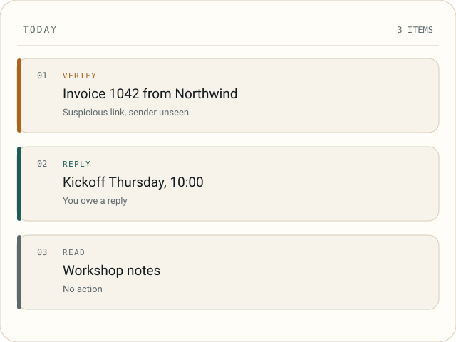
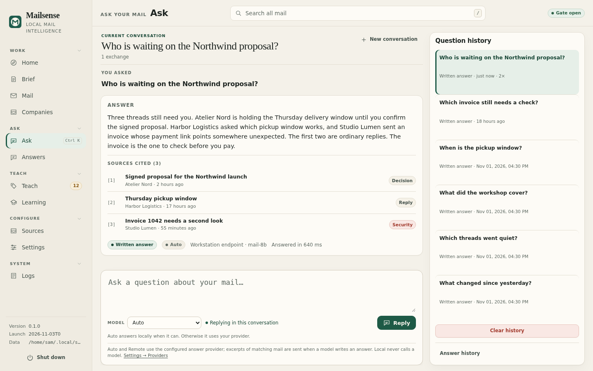
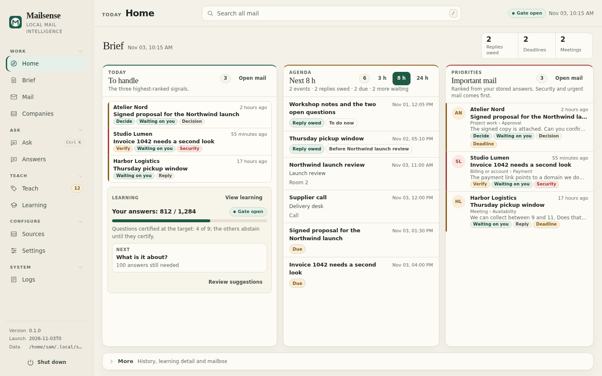
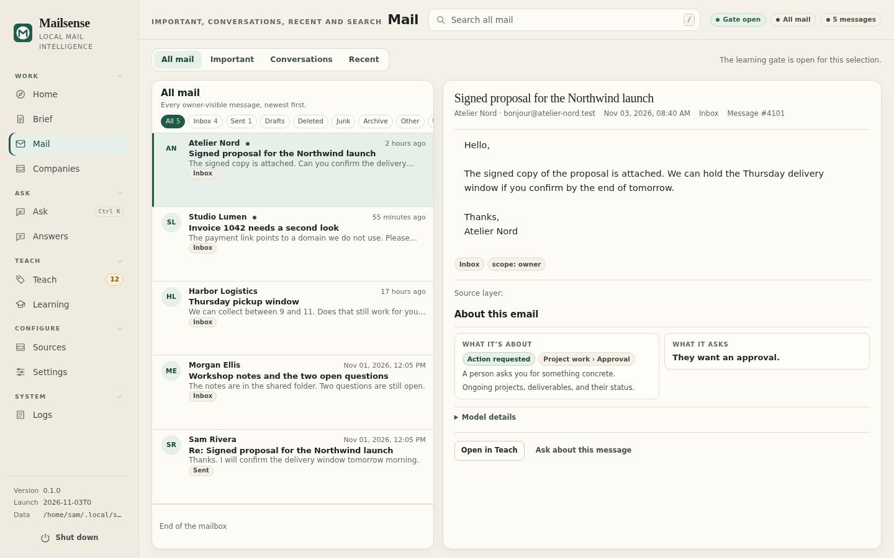
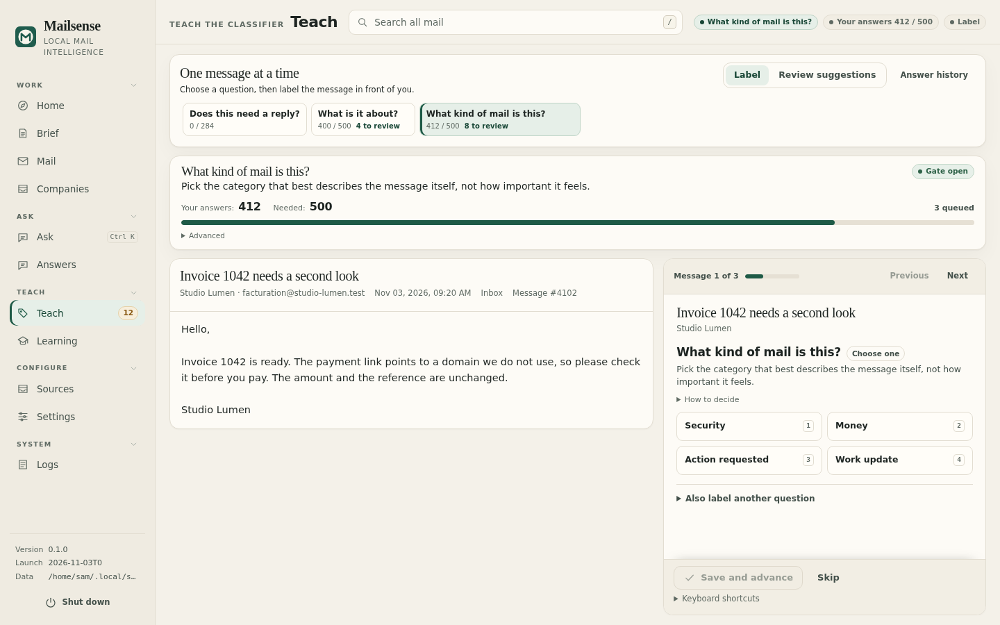
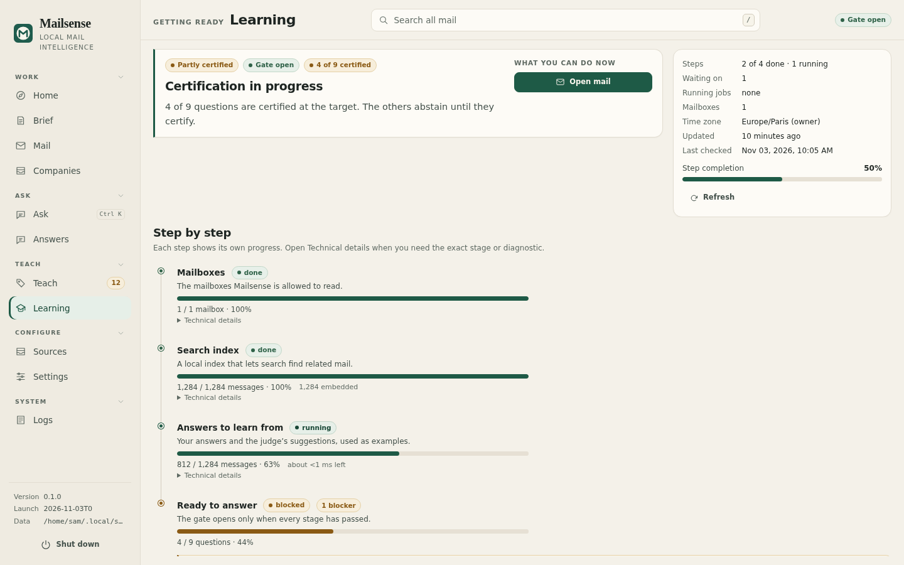
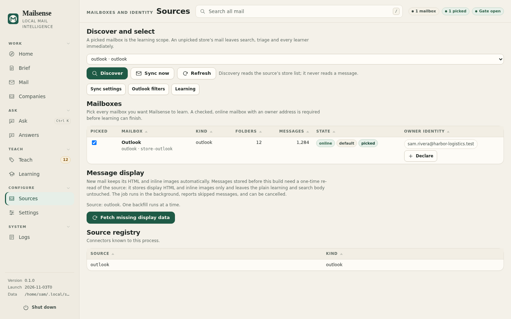
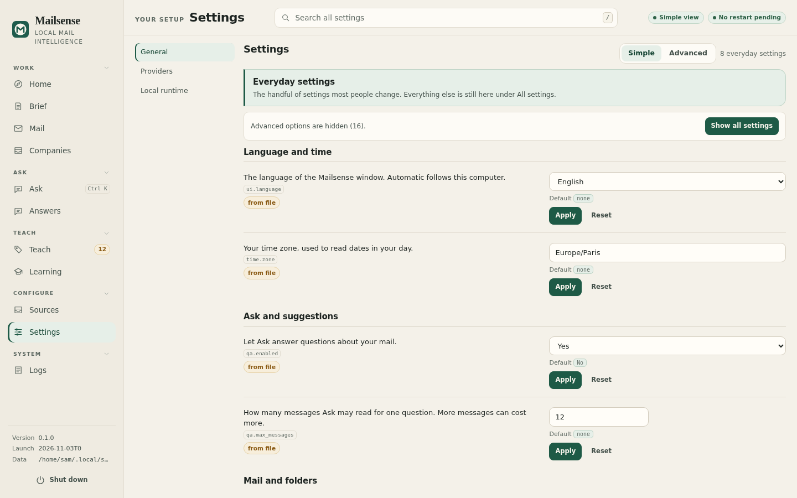
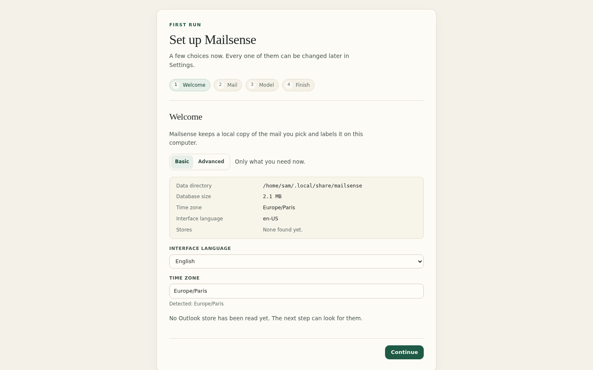

<header class="hero">
  

    
Ask and local triage for Windows

    <h1>Mailsense</h1>
    
Ask your mail a question. It answers with a count, a list, or a written answer that cites the messages it used.

    
It reads the classic Outlook profile already open on your PC. Ask answers from the local index; a written answer comes only from a model you configured and the messages it can cite. The store, the classifier and the learned profile stay on your disk.

    
<a class="button" href="install.html">Install</a><a class="text-link" href="first-run.html">Read the first-run guide</a>

    
Windows installer, or the Linux preview. No account, no telemetry.

  

  <figure class="hero-art">
    
    <figcaption>The queue is the second proof. An invented queue, with the action and the reason on every row.</figcaption>
  </figure>
</header>

[Ask](ask.md) · [Install](install.md) · [First run](first-run.md) · [Console](console.md) · [Mailboxes](mailboxes.md) · [Providers](providers.md) · [Learning](learning.md) · [FAQ](faq.md) · [Privacy](privacy.md) · [Security](security.md) · [Troubleshooting](troubleshooting.md) · [Contributing](contributing.md) · <a href="fr/" hreflang="fr" lang="fr" data-lang-switch="fr">Français</a>

<section class="ask" aria-labelledby="ask-title">
  <h2 id="ask-title">Ask first</h2>
  
Ask answers a question about your mail in plain language. The screen names which mechanism answered it: a typed query, a search, or a model you configured.

  <ol class="ask-list">
    <li>
      
Grounded

      <h3>A written answer cites every message it uses.</h3>
      
The model is asked to write at most 120 words and marks each claim with a message number. The server checks every marker against the retrieved set, refuses an answer whose marker points outside it, renumbers the markers to citation positions and keeps a citation only when it names a real message. When no citation survives, the matching messages stay on screen with a notice that names the cause.

    </li>
    <li>
      
Local

      <h3>A count or a ranking is computed, not written.</h3>
      
A count, a ranking and a company profile are read from the local index and the stored facts. The number and the rows come from a typed query, never from model text. Local mode never calls a model: the same count still answers, and a free-form question returns the matching messages with a notice that says Local never calls a model.

    </li>
    <li>
      
Trace

      <h3>A citation opens the message, and the answer is kept.</h3>
      
Each citation row carries the subject, the sender and the date, and links to the message it names. Each answer is stored with its question, its route, its mode, its citations and, when a model was used, its provider and model. The history rail reopens it, and Clear history removes every stored answer.

    </li>
  </ol>
  
Ask is bounded by <code>qa.max_messages</code>, <code>qa.retrieval_timeout</code>, <code>qa.call_timeout</code> and the two budget settings. A warming index keeps the question and offers Try again.

  
<a class="text-link" href="ask.html">Read the Ask guide</a>

</section>

<section class="differences" aria-labelledby="differences-title">
  <h2 id="differences-title">Three things it does differently</h2>
  
The queue, the evidence and the gate. Each one is a mechanism you can inspect.

  

    <article class="card">
      
01 / Queue

      <h3>The queue is scored by a fixed local policy.</h3>
      
A local Go scorer ranks each message from stored signals: a suspicious message adds 100, a decision 45, a reply 30, urgency and deadline levels add fixed weights, and recency adds at most 12. A score of 20 is the floor, and a suspicious, decision, reply, urgent or deadline signal always enters. Bulk automated mail never enters, however urgent its text.

    </article>
    <article class="card">
      
02 / Evidence

      <h3>Every label names its source.</h3>
      
A decision is stored as answers to named questions, with the confidence each answer carries where the question type has one and the evidence behind it. The message detail shows the fields the model read. When an index is partial, the screen names the missing part.

    </article>
    <article class="card">
      
03 / Learning

      <h3>It abstains until your own labels certify it.</h3>
      
The local classifier trains one head per question on your corrections. A question is certified only when the Wilson lower bound of its answered precision reaches 0.99 on a held-out split, with at least 200 training labels, 50 evaluation labels and 0.5 coverage. Below that threshold it abstains, and the Learning screen names the stage that blocks it.

    </article>
  

</section>

<section class="shots" aria-labelledby="shots-title">
  <h2 id="shots-title">The screens, starting with Ask</h2>
  
Captured from the Linux preview with an invented mailbox. No real mail appears here.

  

    <figure class="shot">
      
      <figcaption><strong>Ask with an answer</strong> Ask leads: a question and its written answer, with every citation under the text opening the message it names.</figcaption>
    </figure>
    <figure class="shot">
      
      <figcaption><strong>Home</strong> The day in three columns: what needs a reply, what needs a decision, and what is coming up.</figcaption>
    </figure>
    <figure class="shot">
      
      <figcaption><strong>Mail with a message open</strong> The selected message shows its sender, its body and the fields the local model read.</figcaption>
    </figure>
    <figure class="shot">
      
      <figcaption><strong>Teach</strong> One question at a time. The suggestion is shown, and your answer is the label that trains the local model.</figcaption>
    </figure>
    <figure class="shot">
      
      <figcaption><strong>Learning</strong> Each stage reports its own progress, and the screen names the step that still blocks certification.</figcaption>
    </figure>
    <figure class="shot">
      
      <figcaption><strong>Sources</strong> The Outlook store, the picked mailbox and the folders Mailsense can read.</figcaption>
    </figure>
    <figure class="shot">
      
      <figcaption><strong>Settings</strong> The everyday settings first. The full schema stays one click away.</figcaption>
    </figure>
    <figure class="shot">
      
      <figcaption><strong>First run</strong> The first launch writes the setup marker, names the data directory and asks for a time zone before it reads any mail.</figcaption>
    </figure>
  

</section>

<section class="boundary" aria-labelledby="boundary-title">
  <h2 id="boundary-title">What leaves the machine</h2>
  
Mailsense makes four kinds of network request. Each one has a reason you can see.

  

    
<h3>Leaves, only when it runs</h3><ul>
      <li>The pinned local runtime and embedding model, downloaded once and checked against SHA-256 before use.</li>
      <li>A request to a remote provider you configured, for an Ask answer or automatic triage after a sync. It carries the question and the message fields that call needs.</li>
      <li>A provider model list when you press Fetch models.</li>
      <li>One small test request when you press Test. A test is billable and is not covered by a budget.</li>
    </ul>

    
<h3>Never leaves</h3><ul>
      <li>The mail store, attachments, indexes and learned profile. They are SQLite files in the data directory you chose.</li>
      <li>The classification, evidence and ranking code. They run as local Go code, not as a cloud call.</li>
      <li>No telemetry, no analytics, no update ping and no vendor account.</li>
    </ul>

  

  
Mailsense reads the classic Outlook profile already open on Windows. It does not ask for Microsoft credentials. A remote provider&#39;s terms govern what it does with a request you send. See <a href="privacy.html">privacy</a>.

</section>

<section class="limits" aria-labelledby="limits-title">
  <h2 id="limits-title">What it cannot do yet</h2>
  
These limits are part of the current build.

  <ol class="limit-list">
    <li>
      <h3>Only classic Outlook on Windows is a live source.</h3>
      
It reads the profile through COM. New Outlook, Outlook on the web, IMAP, POP, the Gmail API, Microsoft Graph and file import are not connected in this build.

    </li>
    <li>
      <h3>The Linux build is a preview.</h3>
      
It opens, renders every screen and explains the missing source. The inbox stays empty because there is no live connector yet.

    </li>
    <li>
      <h3>It reads and ranks. It does not act on the mailbox.</h3>
      
No sending, deleting, moving or read-state changes. The connector is read-only.

    </li>
    <li>
      <h3>Triage needs a decider.</h3>
      
Without one, triage answers 422 provider_not_configured. Search and the local classifier still work.

    </li>
    <li>
      <h3>The database is not encrypted by the app.</h3>
      
Your operating-system account and disk encryption are the protection. Provider keys on Windows use DPAPI.

    </li>
    <li>
      <h3>There is no SQL console and no diagnostics bundle.</h3>
      
Logs are local and readable in the Logs screen. They redact secrets.

    </li>
  </ol>
</section>

<section class="install" id="install" aria-labelledby="install-title">
  

    <h2 id="install-title">Install</h2>
    
Windows is the supported live build. Linux is a preview.

    <h3>Windows</h3>
Download the per-user installer from <a href="https://github.com/LLM-4-People/mailsense/releases">Releases</a>. It needs the Microsoft Edge WebView2 runtime, which Windows 11 and current Windows 10 already have. The build is not code-signed, so Windows may ask you to confirm the publisher.

    <h3>Linux</h3>
Download the amd64 tarball, extract it and run install.sh for a menu entry, or run the binary directly.

  

  

    
Linux preview

    <pre><code>tar -xzf mailsense-*-linux-amd64.tar.gz &amp;&amp; cd mailsense-*-linux-amd64 &amp;&amp; ./install.sh</code></pre>
    
One command for the Linux preview, from the directory that holds the downloaded tarball.

    <a class="button button-light" href="first-run.html">Read the first-run guide</a>
  

</section>

The first run writes the setup marker, lists the Outlook stores and shows the resource ceilings. Nothing is read from mail before you pick a store.

<section class="status" aria-labelledby="status-title">
  <h2 id="status-title">Status</h2>
  
Mailsense is in active development. Interfaces and stored schemas may change between releases; the changelog and the release notes call out anything that requires a migration.

</section>

<footer class="page-footer">
  
<strong>Mailsense</strong> · <a href="https://github.com/LLM-4-People/mailsense">Source</a> · <a href="https://github.com/LLM-4-People/mailsense/LICENSE">AGPL-3.0-or-later</a> · <a href="https://llm-4-people.github.io/mailsense/">Documentation</a>

  
<a href="privacy.html">Privacy</a> · Ask your mail. Every citation opens the message.

</footer>
